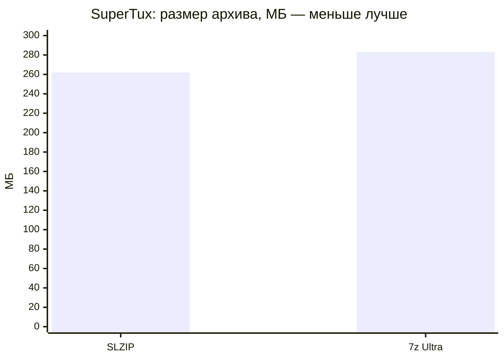
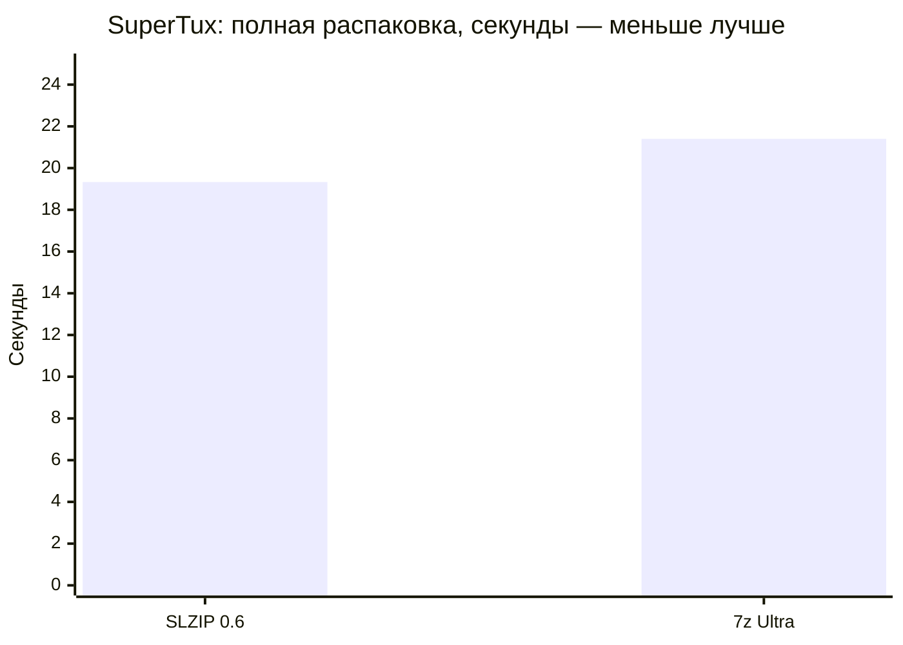
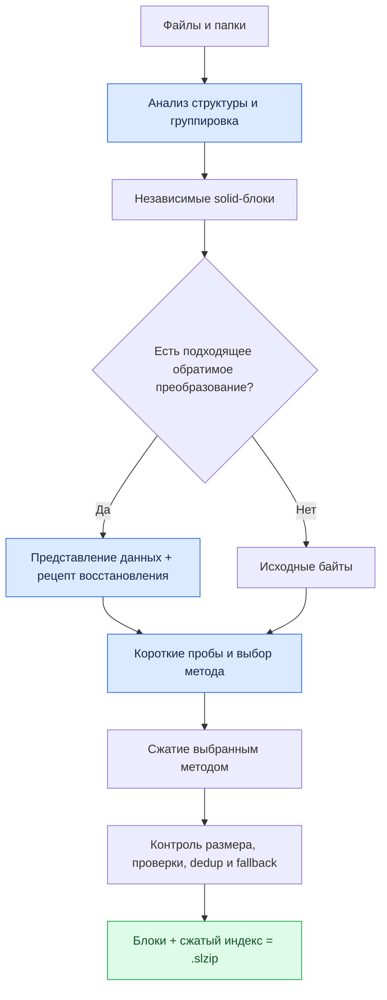
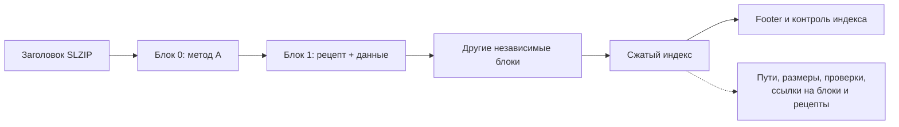
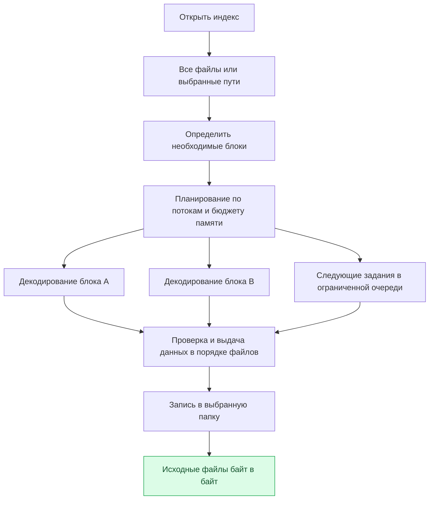
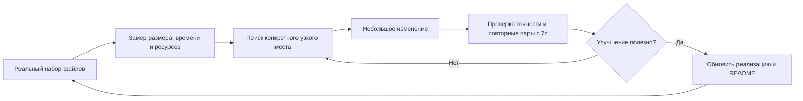

# SlavyaZIP

### Сильное сжатие. Быстрый доступ. Простой интерфейс.

**`.slzip` · Windows x64 · Prerelease · Сжатие без потерь**

Собственный формат архива и минималистичный файловый менеджер. 
Цель — сделать эффективное архивирование обычным ежедневным действием.

[Результаты](#результаты) · [Архитектура](#архитектура) · [Развитие](#развитие) · [Возможности](#возможности)

---

> **Статус: предварительная презентация проекта.** Здесь описаны работающая beta 0.5 и проверенный кандидат 0.6 с ускоренной распаковкой. Публичные сборки и исходники будут представлены отдельно. Измерения актуальны на **10 октября 2026 года**; новые подтверждённые результаты будут обновляться в этом README.

SlavyaZIP разрабатывается как конкурент 7-Zip для повседневной работы: упаковать папку, открыть архив, достать нужный файл, проверить целостность и продолжить работу. Его качество оценивается одновременно по размеру архива, времени упаковки, времени распаковки и расходу ресурсов.

На одной полной смешанной папке игры уже получен измеримый выигрыш по всем трём основным показателям: **архив меньше на 7,46%, упаковка быстрее на 7,97%, распаковка быстрее на 9,70%** относительно проверенного профиля 7z Ultra. Это результат конкретного набора и настроек, а не обещание для каждого файла.

## Результаты

### Полная игра, а не подборка удобных файлов

Проверена **SuperTux 0.7.0 для Windows x64**: **5 215 файлов, 396 564 897 байт** исходных данных. В папке вместе находятся PNG, музыка Ogg/Vorbis, EXE/DLL, PDB, шрифты, тексты и конфигурации.

| Показатель | SlavyaZIP, быстрый профиль | 7-Zip 25.01, 7z Ultra | Разница |
| :--- | ---: | ---: | ---: |
| Размер архива | **261,885 МБ** | 282,999 МБ | **На 7,46% меньше** |
| Упаковка, медиана 3 запусков | **35,73 с** | 38,83 с | **На 7,97% меньше времени** |
| Распаковка, медиана 3 запусков | **19,33 с** | 21,40 с | **На 9,70% меньше времени** |
| Пиковая память при упаковке, медиана | **772 МиБ** | 3 867 МиБ | **Примерно на 80% меньше** |
| Пиковая память при распаковке, медиана | **549 МиБ** | 638 МиБ | **Примерно на 14% меньше** |

**Профили сравнения:** SlavyaZIP — уровень 7, автоматический выбор метода, 6 workers, бюджет 4 096 МиБ; 7-Zip — `-t7z -mx=9 -ms=on`, автоматическое число потоков. Быстрый профиль SlavyaZIP выбирается вручную: это пока не настройки по умолчанию.

Упаковка измерена на beta 0.5, распаковка тех же архивов — на кандидате 0.6. Код упаковки и native-библиотеки в этих версиях совпадают; новые измерения упаковки на 0.6 пока не включены. Три пары запусков каждой операции выполнены последовательно с чередованием порядка программ.

Экономия составляет **21,11 МБ на этой папке**. Относительно дополнительного исторического профиля 7z со словарём 512 МиБ, `fb=273` и `mc=1000` архив SLZIP меньше на **7,33%**. Это отдельная проверка размера, а не сравнение скорости с усиленным профилем.

### Быстро получить нужный файл

При извлечении одного `doc/README.md` размером 5 391 байт из того же полного игрового архива:

| Показатель | SLZIP 0.6, 2 workers / 768 МиБ | 7z Ultra, автоматические потоки |
| :--- | ---: | ---: |
| Время извлечения | **0,59 с** | 3,11 с |
| Пиковая память | **77 МиБ** | 638 МиБ |

Это единичный проверенный сценарий: **примерно в 5,3 раза быстрее**. Индекс SLZIP позволяет распаковать блоки, содержащие выбранный файл. В проверенном solid-архиве 7z требовалась большая работа. Другие размеры solid-блоков у 7z могут изменить этот результат.

### Ресурсы и границы результата

Быстрый профиль использует больше суммарного процессорного времени: при упаковке медиана около **171 против 88 CPU-секунд**, при распаковке — **62 против 22**. Он раньше завершает операцию благодаря параллелизму, но не доказан как более экономичный по энергии. Электропотребление не измерялось.

Бюджет памяти регулирует планирование и выбор методов; **он не является жёстким пределом RSS всего приложения**. У native-помощников есть отдельные ограничения.

Режим распаковки по умолчанию — **2 workers / 768 МиБ** — на полной SuperTux в отдельном запуске дал **49,55 с**, тогда как однопоточный архив 7z распакован за **22,02 с**. Поэтому выигрыш быстрого профиля пока нельзя переносить на обычные настройки.

### Другие данные тоже проверяются

На 14 наборах получены как выигрыши, так и ограничения. Некоторые наборы являются поднаборами игр; их результаты нельзя усреднять как независимую выборку всех пользовательских данных.

<strong>Открыть результаты по типам данных</strong>

Размеры — архивы beta 0.5 с одним compression worker, 7z Ultra также с одним потоком. Распаковка — свежие проверки кандидата 0.6 с 2 workers / 768 МиБ против этих 7z-архивов. Для небольших наборов время включает заметную долю запуска приложения.

| Набор | Размер SLZIP относительно 7z | Распаковка SLZIP / 7z, с |
| :--- | :--- | ---: |
| Minetest_game, полный пакет | На **0,95% меньше** | **2,49 / 4,05** |
| OpenTTD 15.3, полная игра | На **0,50% меньше** | 2,28 / 0,63 |
| Музыка Ogg/Vorbis | На **7,54% меньше** | 2,07 / 0,33 |
| Canterbury | На **12,47% меньше** | 0,53 / 0,10 |
| XLSX | На **34,87% меньше** | 0,53 / 0,10 |
| CSV | На **19,58% меньше** | 0,27 / 0,08 |
| Тексты и конфигурации | На **19,47% меньше** | 2,30 / 1,62 |
| EXE/DLL | На 0,93% больше | 2,11 / 0,58 |
| Исходный код | На 0,64% больше | 0,93 / 0,67 |
| JPEG | На 0,02% больше | 0,33 / 0,16 |
| Вложенные ZIP | На 0,02% больше | 0,40 / 0,18 |
| ZIP внутри ZIP | Больше на 77 байт | 0,28 / 0,08 |
| Случайные 4 МиБ | Больше на 36 байт | 0,28 / 0,08 |

Полная SuperTux приведена отдельно выше. Каждый результат распаковки проверен по SHA-256 исходных файлов. Выигрыш в размере на XLSX или музыке сам по себе не означает лучший ежедневный опыт: скорость также учитывается.

**Текущая оценка:** SLZIP уже имеет практическое преимущество на проверенной смешанной игре и при выборочном извлечении. Оснований рекомендовать его как универсальную замену 7-Zip для всех пользователей пока недостаточно. Это prerelease с работающей архитектурой и проверяемым направлением развития.

## Архитектура

### Главная идея: выбрать полезное представление данных

Обычное сжатие ищет закономерности в поступивших байтах. Но часть файлов уже содержит сжатый поток: например, PNG, ZIP или Ogg/Vorbis. SLZIP для поддерживаемых структур может сначала получить **обратимое представление и рецепт восстановления**, а затем сжать это представление.

Рецепт нужен, чтобы восстановить **тот же исходный файл байт в байт**, включая его прежнюю упаковку и служебные данные. Изображение не меняется, звук не перекодируется с потерями, исходный ZIP не заменяется другим ZIP с похожим содержимым.

Для обычного блока короткие распределённые пробы помогают выбрать метод; затем блок полностью кодируется одним выбранным кодеком. Специализированные рецепты могут содержать несколько потоков. Если преобразование не поддержано, проверка не проходит или результат невыгоден, используются обычное представление либо хранение байтов.

| Часть системы | Что она делает |
| :--- | :--- |
| **Fast LZMA2** | Основной универсальный путь сжатия с параллельной обработкой |
| **BSC / BWT + QLFC и PPMd** | Альтернативы для блоков, где их выбирают короткие пробы |
| **PNG и DEFLATE-рецепты** | Обратимое представление поддерживаемых потоков с восстановлением исходных байтов |
| **Ogg/Vorbis** | Специализированное точное представление через balrogg, быстрый effort 1 |
| **Windows EXE/DLL** | Разбор PE-секций; BCJ2 для кода, предсказатели для подходящих числовых таблиц |
| **Группировка и solid-блоки** | Использование повторов между похожими файлами внутри ограниченного блока |
| **Дедупликация** | Повторное использование идентичных блоков |
| **Планировщик ресурсов** | Ограниченные очереди и выбор параллелизма по оценке памяти |

### Контейнер отделён от выбранного метода

`.slzip` — собственный контейнер. Метод, рецепт и параметры описаны в индексе, поэтому разные блоки одного архива могут храниться по-разному и читаться независимо.

Это схема логической организации, а не побайтовая спецификация. Независимость блоков позволяет улучшать планирование распаковки, не меняя уже созданные архивы.

### Отличие от 7z

**7-Zip** — программа, **7z** — её основной формат; **SlavyaZIP** — программа, **SLZIP** — новый формат этого проекта.

Сам 7z уже имеет расширяемую архитектуру, несколько кодеков, solid-сжатие, BCJ/BCJ2 и другие фильтры. Поэтому независимые блоки, фильтры или использование нескольких алгоритмов не объявляются изобретениями SlavyaZIP. Эти возможности описаны в [официальной документации 7z](https://www.7-zip.org/7z.html).

Отличие текущей реализации SLZIP — в сочетании **структурных рецептов, автоматического выбора представления, небольших независимых блоков и планирования чтения**. Преимущество ищется во всём пути от исходного файла до его восстановления.

| Решение | Практический смысл для SLZIP |
| :--- | :--- |
| Распознавать поддерживаемую внутреннюю структуру файла | Найти закономерности, скрытые прежним сжатием |
| Сохранять рецепт точного восстановления | Получить дополнительное сжатие без изменения исходного файла |
| Выбирать методы короткими пробами | Уменьшить стоимость перебора при упаковке |
| Ограничивать независимые блоки | Балансировать межфайловые повторы, память и доступ к отдельным файлам |
| Отдельно настраивать упаковку и чтение | Быстрее распаковывать существующий архив на более подходящем ПК |
| Считать размер, время и ресурсы вместе | Отбрасывать улучшения, которые дают мало экономии за слишком долгое ожидание |

Проект использует известные алгоритмы и библиотеки вместе с собственным контейнером, предсказателями и управляющим кодом. Фундаментально новый универсальный алгоритм сжатия в этой версии не заявляется.

### Распаковка как самостоятельная задача

В кандидате 0.6 декодирование независимых блоков выполняется параллельно с ограниченной очередью. Готовые данные выдаются в нужном порядке; создание файлов также организовано с ограниченным параллелизмом. Выборочное извлечение обрабатывает только требуемые блоки.

Индекс, упакованные блоки, восстановленные данные и файлы имеют проверки целостности. Извлечение проверяет пути и ограничивает выход за выбранную папку. Эти проверки обнаруживают повреждения и ошибки; они не заменяют криптографическую аутентификацию архива.

## Развитие

### Небольшие изменения, которые складываются в практический выигрыш

| Этап | Что изменилось | Что это даёт |
| :--- | :--- | :--- |
| Основа формата | Независимые блоки, индекс, автоматический выбор методов и обратимые рецепты | Возможность улучшать отдельные части без замены всей системы |
| **Beta 0.5** | Точное представление Vorbis и более подходящий выбор пути для коротких аудиоэффектов; ограниченная очередь упаковки | На полной SuperTux достигнут выигрыш более 7% по размеру и измерен выигрыш быстрого профиля при упаковке |
| **Кандидат 0.6** | Параллельное чтение, улучшение создания файлов, отдельные настройки распаковки и проверки | Тот же игровой архив распаковывается за медианные 19,33 с; старые SLZIP 1/2 продолжают читаться |
| Следующий этап | Ускорение малых архивов и обычного профиля, расширение тестовых данных | Сделать преимущества полезными без ручной настройки |
| Долгосрочная цель | Более полная совместимость и удобство обмена архивами | Достойный повседневный конкурент 7-Zip |

В прежней проверке 0.5 быстрая распаковка полной SuperTux занимала **62,25 с**; в повторной серии 0.6 медиана — **19,33 с**. Это историческое сравнение разных серий, а не контрольный замер двух версий в одинаковых условиях. Но оно показывает важную возможность: уже созданный архив получил существенно более быстрый reader **без изменения своего размера и байтов**.

7-Zip накопил большой опыт развития. SlavyaZIP может опираться на уже существующие библиотеки и исследования и проверять небольшие изменения короткими циклами. Такая организация помогает быстрее испытывать идеи; она **не гарантирует**, что молодой проект обгонит зрелый архиватор во всех задачах или за определённый срок.

### Сильное сжатие по умолчанию — цель продукта

Пользователь не должен искать особый режим ради хорошего результата. Направление разработки — автоматический профиль, который учитывает структуру данных и доступные ресурсы, сохраняя разумную скорость упаковки и чтения.

В текущей beta упаковка по умолчанию использует **уровень 7, словарь 16 МиБ, блок 32 МиБ, 1 worker и бюджет 256 МиБ**. Она уже применяет специализированные пути автоматически, но быстрый профиль из главной таблицы включается отдельно. Перенос его преимуществ в удобный обычный режим ещё требует работы.

Ultra у 7-Zip — выбранная здесь строгая база сравнения; 7-Zip также предлагает другие уровни. SLZIP не использует настройку 7-Zip «Ultra»: задача проекта — получать конкурентоспособный результат собственной политикой выбора методов.

## Возможности

| Уже реализовано в рабочей beta | Состояние |
| :--- | :--- |
| Минималистичный файловый менеджер с русским интерфейсом | Работает |
| Создание, просмотр, проверка и извлечение SLZIP и ZIP | Работает |
| Извлечение выбранных файлов и папок | Работает |
| Уровень, метод, словарь, блок, потоки и бюджет памяти | Настраиваются |
| Автоматический выбор методов и специализированных преобразований | Работает |
| Отмена операций и проверки целостности | Реализованы |
| GUI и командная строка | Реализованы |
| Параллельная распаковка и отдельные настройки чтения | Проверены в кандидате 0.6 |
| Windows x64 | Текущая целевая платформа |

Пока отсутствуют чтение 7z/RAR, шифрование и пароли, многотомные архивы, SFX, интеграция с контекстным меню и обновление архива на месте. SLZIP также не является полным средством резервного копирования ACL и альтернативных потоков NTFS. Поддержка Opus в специализированном аудиопути отключена.

### Приоритеты перед широким использованием

- Ускорить обычный профиль распаковки и уменьшить накладные расходы на небольших архивах.
- Расширить проверки на независимые смешанные наборы и многогигабайтные игры.
- Повторять сравнения на разных ПК, включая системы с ограниченной памятью.
- Добавлять совместимость с распространёнными форматами и необходимые ежедневные функции.
- Сохранять читаемость старых архивов и проверять каждый новый рецепт байт в байт.
- Публиковать команды, происхождение данных, исходники и полные результаты вместе со сборками.

## Как проверяются заявления

Измерения выполнены на одном ПК: Windows 11 x64, **6 физических / 12 логических ядер, 16 ГиБ RAM**, 7-Zip **25.01**. МБ здесь означает 1 000 000 байт; МиБ — 1 048 576 байт.

Операции запускаются отдельными процессами последовательно. Wall time включает запуск программы и работу с файлами. Память и CPU всей семьи процессов измеряются выборкой примерно каждые 10 мс. После распаковки **все восстановленные файлы сверяются по SHA-256 с исходниками**, вне замера скорости.

Для повторных упаковок совпадение SHA-256 архива подтверждало идентичность ранее полностью распакованному результату; новый результат требовал отдельной проверки. В повторной серии распаковки SuperTux времена SLZIP составили **19,36 / 18,73 / 19,33 с**, 7z — **23,09 / 21,40 / 20,77 с**. Основная таблица использует медианы, а не лучший запуск.

Упаковочные медианы: SLZIP **35,73 / 36,84 / 35,47 с**, 7z **38,83 / 38,74 / 38,93 с**. Полная распаковка прошла проверку на всех 14 наборах; кандидат 0.6 также прошёл **54 автоматических теста** и проверки двух вариантов Windows-сборки.

Проверка настоящей игры объёмом 5 ГБ и сравнения с PAQ/CMIX в эту серию не входят. Цифры не являются прогнозом для другого ПК, любых файлов или холодного дискового кэша. Универсальный выигрыш на всех возможных входных данных не заявляется.

## На чём основан проект

SlavyaZIP использует и адаптирует существующие технологии: [Fast LZMA2](https://github.com/conor42/fast-lzma2), [libbsc](https://github.com/IlyaGrebnov/libbsc), компоненты LZMA/PPMd, packPNG/preflate и закреплённый [balrogg](https://github.com/iczelia/balrogg/tree/d85fe1e77b8423fc9188d74e699af95bff204eb8) для Ogg/Vorbis. Balrogg создан **Kamila Szewczyk** и распространяется под GPL-3.0. Эти кодеки не выдаются за собственные изобретения проекта.

Собственная работа проекта — контейнер SLZIP, интеграция методов, политика выбора представлений, предсказатели, группировка, управление очередями и ресурсами, reader и интерфейс. При публикации исходников и сборок должны сохраняться лицензии и требования всех используемых компонентов.

---

**SlavyaZIP развивается ради повседневной пользы.** 
Меньше места, меньше ожидания и больше удобства — с результатами, которые можно проверить.

